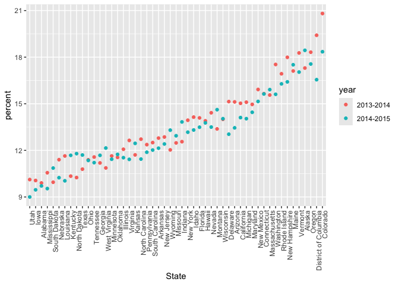
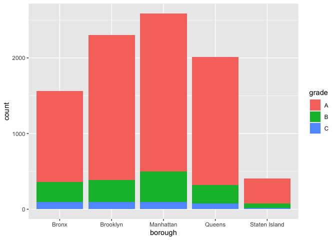
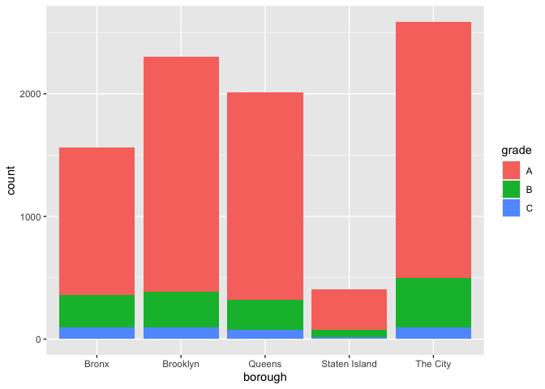
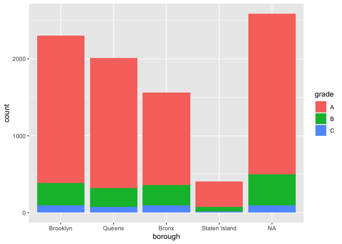
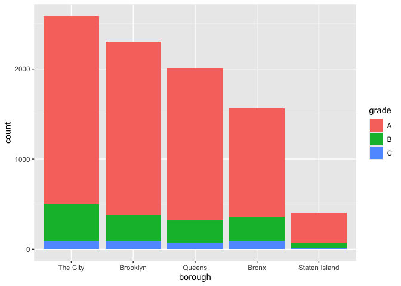
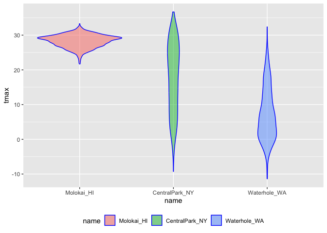
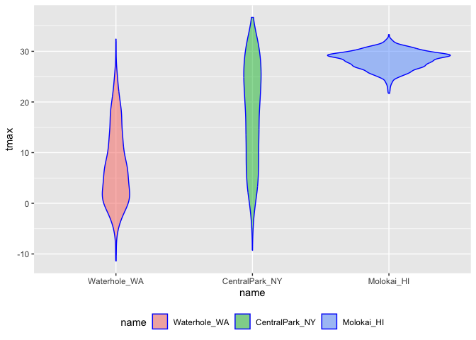
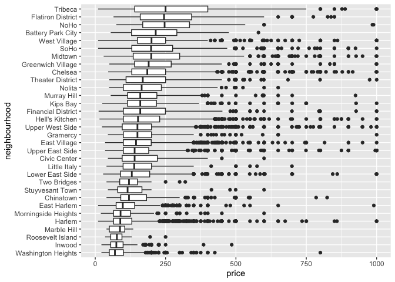

string and factors
================
2026-11-03

## Strings and Regex

``` r
# The most frequent operation involving strings is to search for an exact match; `str_detect` is used to find cases where the match exists and often used in conjunction `filter()`;`str_replace` can be used to replace an instance of a match with something else and often used in conjuction with `mutate()`.

string_vec = c("my", "name", "is", "emanuel") 

str_detect(string_vec, "emanuel")
```

    ## [1] FALSE FALSE FALSE  TRUE

``` r
str_replace(string_vec, "emanuel", "Emanuel")
```

    ## [1] "my"      "name"    "is"      "Emanuel"

``` r
# For exact matches, you can designate matches at the beginning or end of a line.

string_vec = c(
  "i think we all rule for participating",
  "i think i have been caught",
  "i think this will be quite fun actually",
  "it will be fun, i think"
)

str_detect(string_vec, "^i think")
```

    ## [1]  TRUE  TRUE  TRUE FALSE

``` r
str_detect(string_vec, "i think$")
```

    ## [1] FALSE FALSE FALSE  TRUE

``` r
# You can desinate a list of characters that will count as a match.

string_vec = c(
  "Time for a Pumpkin Spice Latte!",
  "went to the #pumpkinpatch last weekend",
  "Pumpkin Pie is obviously the best pie",
  "SMASHING PUMPKINS --- LIVE IN CONCERT!!"
)

str_detect(string_vec,"[Pp]umpkin")
```

    ## [1]  TRUE  TRUE  TRUE FALSE

``` r
# You don't have to list these; instead, you can provide a range of letters or numbers that count as a match.

string_vec = c(
  '7th inning stretch',
  '1st half soon to begin. Texas won the toss.',
  'she is 5 feet 4 inches tall',
  '3AM - cant sleep :('
)

str_detect(string_vec, "^[0-9][a-zA-Z]")
```

    ## [1]  TRUE  TRUE FALSE  TRUE

``` r
# The character `.` matches anything.

string_vec = c(
  'Its 7:11 in the evening',
  'want to go to 7-11?',
  'my flight is AA711',
  'NetBios: scanning ip 203.167.114.66'
)

str_detect(string_vec, "7.11")
```

    ## [1]  TRUE  TRUE FALSE  TRUE

``` r
# Some characters are "special." These include `[` and `]`, and `(` and `)`, and `.`. To search for these, you have to indicate they're special using `\`, which can get complicated.

string_vec = c(
  'The CI is [2, 5]',
  ':-]',
  ':-[',
  'I found the answer on pages [6-7]'
)

str_detect(string_vec, "\\[")
```

    ## [1]  TRUE FALSE  TRUE  TRUE

## Thoughts on Factors

``` r
# Factors are the way to store categorical variables in R, taking on specific levels (e.g., male and female), which are usually presented as characters but are in fact store by R as integers. These integer values are used by functions through R in making plots, organizing tables, etc.

vec_sex = factor(c("male", "male", "female", "female"))
vec_sex
```

    ## [1] male   male   female female
    ## Levels: female male

``` r
as.numeric(vec_sex)
```

    ## [1] 2 2 1 1

``` r
vec_sex = fct_relevel(vec_sex, "male")
vec_sex
```

    ## [1] male   male   female female
    ## Levels: male female

``` r
as.numeric(vec_sex)
```

    ## [1] 1 1 2 2

``` r
# The code above illustrates coercion, which is forcing a variable from one type to another (i.e., factor to numeric). Using `forcats` helps deliberate factors.
```

## NSDUH Example

``` r
nsduh_url = "https://www.samhsa.gov/data/sites/default/files/NSDUHsaeShortTermCHG2015/NSDUHsaeShortTermCHG2015.htm"

table_marj = 
  read_html(nsduh_url) |> 
  html_table() |> 
  first() |>
  slice(-1)

data_marj = 
  table_marj |>
  select(-contains("P Value")) |>
  pivot_longer(
    -State,
    names_to = "age_year", 
    values_to = "percent") |>
  separate(age_year, into = c("age", "year"), sep = "\\(") |>  # `separate()` splits age and year as the open parenthesis using `"\\("`,
  mutate(                                                      # close parenthesis is stripped out in `mutate()`.
    year = str_replace(year, "\\)", ""),
    percent = str_replace(percent, "[a-c]$", ""),              # to remove character superscripts, replace any character using `"[a-c]$"`.
    percent = as.numeric(percent)) |>
  filter(!(State %in% c("Total U.S.", "Northeast", "Midwest", "South", "West")))

# To visualize data for the 12-17 age group, make a readable plot by treating `State` as a factor are reorder according to the median `Percent` value.

data_marj |>
  filter(age == "12-17") |> 
  mutate(State = fct_reorder(State, percent)) |> 
  ggplot(aes(x = State, y = percent, color = year)) + 
    geom_point() + 
    theme(axis.text.x = element_text(angle = 90, hjust = 1))
```

<!-- -->

## Restaurant Inspections Example

``` r
data("rest_inspec")

rest_inspec = 
    rest_inspec |> 
    rename(borough = boro)

rest_inspec |> 
  group_by(borough, grade) |> 
  summarize(n = n()) |> 
  pivot_wider(names_from = grade, values_from = n)
```

    ## `summarise()` has regrouped the output.
    ## ℹ Summaries were computed grouped by borough and grade.
    ## ℹ Output is grouped by borough.
    ## ℹ Use `summarise(.groups = "drop_last")` to silence this message.
    ## ℹ Use `summarise(.by = c(borough, grade))` for per-operation grouping
    ##   (`?dplyr::dplyr_by`) instead.

    ## # A tibble: 6 × 9
    ## # Groups:   borough [6]
    ##   borough           A     B     C  `NA`     N     P     Z     G
    ##   <chr>         <int> <int> <int> <int> <int> <int> <int> <int>
    ## 1 0                33     9     6    67    NA    NA    NA    NA
    ## 2 Bronx         14071  2611   976 17190   161   236   605    NA
    ## 3 Brooklyn      38896  6423  2194 49825   345   782  1168     2
    ## 4 Manhattan     61675  9107  3600 76581   591   924  1816     3
    ## 5 Queens        36258  5526  1996 44136   350   604  1287    NA
    ## 6 Staten Island  5410   855   248  6315    71    61   116    NA

``` r
# To simplify, remove inspections with scores other than `A`, `B`, or `C`, and remove the restaurants with missing borough information; also clean up borough names

rest_inspec =
  rest_inspec |>
  filter(grade %in% c("A", "B", "C"), borough != "Missing") |> 
  mutate(borough = str_to_title(borough))

# To focus only a pizza places and re-examine grades by borough

rest_inspec |> 
  filter(str_detect(dba, "Pizza")) |> 
  group_by(borough, grade) |> 
  summarize(n = n()) |> 
  pivot_wider(names_from = grade, values_from = n)
```

    ## `summarise()` has regrouped the output.
    ## ℹ Summaries were computed grouped by borough and grade.
    ## ℹ Output is grouped by borough.
    ## ℹ Use `summarise(.groups = "drop_last")` to silence this message.
    ## ℹ Use `summarise(.by = c(borough, grade))` for per-operation grouping
    ##   (`?dplyr::dplyr_by`) instead.

    ## # A tibble: 4 × 3
    ## # Groups:   borough [4]
    ##   borough       A     B
    ##   <chr>     <int> <int>
    ## 1 Bronx        15     3
    ## 2 Brooklyn     15    NA
    ## 3 Manhattan    13     3
    ## 4 Queens       11     4

``` r
# Identify the problem: the match in `str_detect()` is case-sensitive until it is told not to be

rest_inspec |> 
  filter(str_detect(dba, "[Pp][Ii][Zz][Zz][Aa]")) |> 
  group_by(borough, grade) |> 
  summarize(n = n()) |> 
  pivot_wider(names_from = grade, values_from = n)
```

    ## `summarise()` has regrouped the output.
    ## ℹ Summaries were computed grouped by borough and grade.
    ## ℹ Output is grouped by borough.
    ## ℹ Use `summarise(.groups = "drop_last")` to silence this message.
    ## ℹ Use `summarise(.by = c(borough, grade))` for per-operation grouping
    ##   (`?dplyr::dplyr_by`) instead.

    ## # A tibble: 5 × 4
    ## # Groups:   borough [5]
    ##   borough           A     B     C
    ##   <chr>         <int> <int> <int>
    ## 1 Bronx          1201   261    98
    ## 2 Brooklyn       1919   291    95
    ## 3 Manhattan      2091   400    96
    ## 4 Queens         1695   239    78
    ## 5 Staten Island   328    60    15

``` r
# Visualizing the table

rest_inspec |> 
  filter(str_detect(dba, "[Pp][Ii][Zz][Zz][Aa]")) |>
  ggplot(aes(x = borough, fill = grade)) + 
  geom_bar() 
```

<!-- -->

``` r
# Updating the plot to visualize things in a different order  using `fct_infreq()`

rest_inspec |> 
  filter(str_detect(dba, "[Pp][Ii][Zz][Zz][Aa]")) |>
  mutate(borough = fct_infreq(borough)) |>
  ggplot(aes(x = borough, fill = grade)) + 
  geom_bar() 
```

<!-- -->

``` r
# To rename a borough, use `str_replace()`

rest_inspec |> 
  filter(str_detect(dba, "[Pp][Ii][Zz][Zz][Aa]")) |>
  mutate(
    borough = fct_infreq(borough),
    borough = str_replace(borough, "Manhattan", "The City")) |>
  ggplot(aes(x = borough, fill = grade)) + 
  geom_bar() 
```

<!-- -->

``` r
# Renaming the borough through this approach also converts the result back to a string which, when plotted, will implicitly make a factor and order alphabetically. In Base R, `replace()` is used to resolve this, but might not always work.

rest_inspec |> 
  filter(str_detect(dba, "[Pp][Ii][Zz][Zz][Aa]")) |>
  mutate(
    borough = fct_infreq(borough),
    borough = replace(borough, which(borough == "Manhattan"), "The City")) |>
  ggplot(aes(x = borough, fill = grade)) + 
  geom_bar()
```

    ## Warning: There was 1 warning in `mutate()`.
    ## ℹ In argument: `borough = replace(borough, which(borough == "Manhattan"), "The
    ##   City")`.
    ## Caused by warning in `[<-.factor`:
    ## ! invalid factor level, NA generated

<!-- -->

``` r
# The above pipeline did not work as factors have very specific values and trying to use a value that is not an existing factor level won't work.

# the following function for renaming factor levels:

rest_inspec |> 
  filter(str_detect(dba, regex("pizza", ignore_case = TRUE))) |>
  mutate(
    borough = fct_infreq(borough),
    borough = fct_recode(borough, "The City" = "Manhattan")) |>
  ggplot(aes(x = borough, fill = grade)) + 
  geom_bar()
```

<!-- -->

## Weather Data Example

``` r
data("weather_df")

# The following pipeline reorders `name` by hand using `fct_relevel()`

weather_df |>
  mutate(name = forcats::fct_relevel(name, c("Molokai_HI", "CentralPark_NY", "Waterhole_WA"))) |>
  ggplot(aes(x = name, y = tmax)) +
  geom_violin(aes(fill = name), color = "blue", alpha = 0.5) +
  theme(legend.position = "bottom")
```

    ## Warning: Removed 17 rows containing non-finite outside the scale range
    ## (`stat_ydensity()`).

<!-- -->

``` r
# The following pipeline reorders `name` according to `tmax` values in each name using `fct_reorder`

weather_df |>
  mutate(name = forcats::fct_reorder(name, tmax)) |> 
  ggplot(aes(x = name, y = tmax)) + 
  geom_violin(aes(fill = name), color = "blue", alpha = .5) + 
  theme(legend.position = "bottom")
```

    ## Warning: There was 1 warning in `mutate()`.
    ## ℹ In argument: `name = forcats::fct_reorder(name, tmax)`.
    ## Caused by warning:
    ## ! `fct_reorder()` removing 17 missing values.
    ## ℹ Use `.na_rm = TRUE` to silence this message.
    ## ℹ Use `.na_rm = FALSE` to preserve NAs.
    ## Removed 17 rows containing non-finite outside the scale range
    ## (`stat_ydensity()`).

<!-- -->

``` r
# Ordering determines the "reference" category and is something can be adjusted as needed.

weather_df |>
  lm(tmax ~ name, data = _) # `_` is a placeholder for the result of the preceding call.
```

    ## 
    ## Call:
    ## lm(formula = tmax ~ name, data = weather_df)
    ## 
    ## Coefficients:
    ##      (Intercept)    nameMolokai_HI  nameWaterhole_WA  
    ##            17.66             10.66            -10.28

``` r
weather_df |>
  mutate(name = forcats::fct_relevel(name, c("Molokai_HI", "CentralPark_NY", "Waterhole_WA"))) |> 
  lm(tmax ~ name, data = _)
```

    ## 
    ## Call:
    ## lm(formula = tmax ~ name, data = mutate(weather_df, name = forcats::fct_relevel(name, 
    ##     c("Molokai_HI", "CentralPark_NY", "Waterhole_WA"))))
    ## 
    ## Coefficients:
    ##        (Intercept)  nameCentralPark_NY    nameWaterhole_WA  
    ##              28.32              -10.66              -20.94

# PULSE Data Example

``` r
# The code below updates the data processing pipeline for the PULSE data using stringr and forcats. The result is the same, and the differences are pretty small, but this is a bit cleaner.

pulse_data = 
  haven::read_sas("./data/public_pulse_data.sas7bdat") |>
  janitor::clean_names() |>
  pivot_longer(
    bdi_score_bl:bdi_score_12m,
    names_to = "visit", 
    names_prefix = "bdi_score_",
    values_to = "bdi") |>
  select(id, visit, everything()) |>
  mutate(
    visit = str_replace(visit, "bl", "00m"),
    visit = factor(visit)) |>
  arrange(id, visit)

print(pulse_data, n = 12)
```

    ## # A tibble: 4,348 × 5
    ##       id visit   age sex     bdi
    ##    <dbl> <fct> <dbl> <chr> <dbl>
    ##  1 10003 00m    48.0 male      7
    ##  2 10003 01m    48.0 male      1
    ##  3 10003 06m    48.0 male      2
    ##  4 10003 12m    48.0 male      0
    ##  5 10015 00m    72.5 male      6
    ##  6 10015 01m    72.5 male     NA
    ##  7 10015 06m    72.5 male     NA
    ##  8 10015 12m    72.5 male     NA
    ##  9 10022 00m    58.5 male     14
    ## 10 10022 01m    58.5 male      3
    ## 11 10022 06m    58.5 male      8
    ## 12 10022 12m    58.5 male     NA
    ## # ℹ 4,336 more rows

# AirBNB Example

``` r
# We could also use factors in an exploratory analysis of the Airbnb data, for example when looking at the distribution of prices in various neighborhoods. Ordering these according to the median price makes for clearer plots than ordering neighborhoods alphabetically.

data("nyc_airbnb")

nyc_airbnb |>
  filter(neighbourhood_group == "Manhattan") |> 
  mutate(
    neighbourhood = fct_reorder(neighbourhood, price)) |> 
  ggplot(aes(x = neighbourhood, y = price)) +
  geom_boxplot() +
  coord_flip() + 
  ylim(0, 1000)
```

    ## Warning: Removed 109 rows containing non-finite outside the scale range
    ## (`stat_boxplot()`).

<!-- -->
